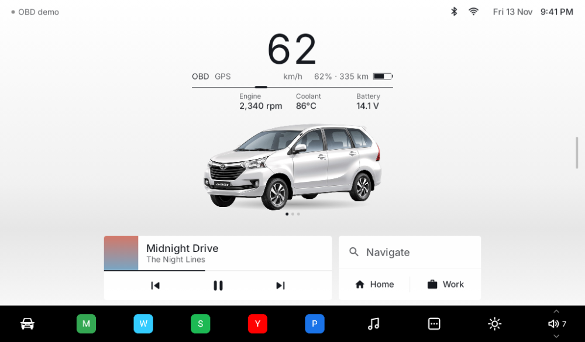
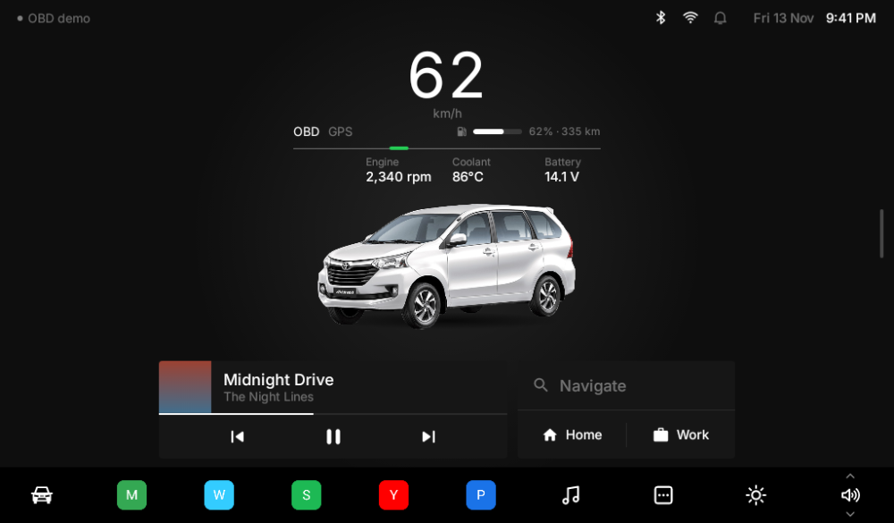
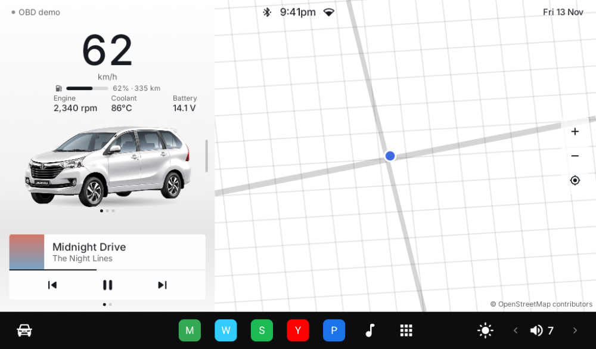
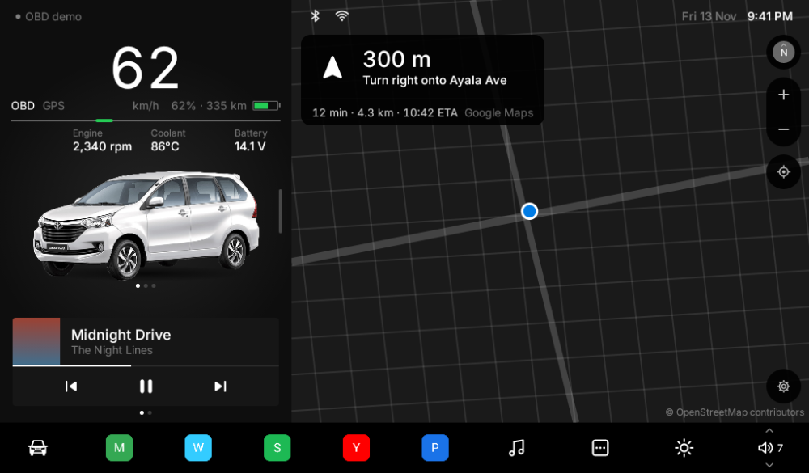

# AHU-TLauncher

A home-screen launcher for Android head units, built with Kotlin and Jetpack Compose. Its look is modelled on Tesla's in-car screen: the car as the hero with a floor reflection and data callouts, a split car/map view, and a dark dock. Colors and type follow [`docs/DESIGN.md`](docs/DESIGN.md). It was made for a **2018 Toyota Avanza (manual)** but works in any car.

| Car view (day) | Car view (night) |
|---|---|
|  |  |
| **Car + map** | **Navigating with Google Maps / Waze** |
|  |  |

These screenshots are rendered offline, so they show a placeholder street grid and letter icons. On the device you see the real map and your real app icons.

## Features
- **Home launcher**: a dock with up to 6 pinned apps, and a searchable app drawer. Long-press an app in the drawer to pin or unpin it.
- **Car view**: shows the Avanza photos bundled in the app, with a floor reflection and callouts for engine RPM, coolant temperature and battery voltage. Tap the car to switch between front, side and rear. Swipe the car panel sideways (anywhere except the cards, or from the map's edge next to it) to switch between the full-screen car and the car + map split: the edge follows your finger and settles when you let go. Tapping the handle on the panel edge does the same.
- **Warning lights** that appear only when needed: OBD connected, engine cold or overheating, battery voltage out of range.
- **3D car**: on head units with OpenGL ES 3, the car panel shows a 3D model of the Avanza in a studio, staged like the Tesla UI prototype's vehicle scene: seen from above in split view, the camera swings down to a low 3/4 view as you swipe to full screen. The car stands on a satin floor with its reflection, a soft shadow and its headlight beams (a pale floor in the day theme). In full screen, drag the car to look around it; double-tap, or leave it for 5 s, and it turns back. Pick the paint in *Settings → Display → Car → Paint colour* (metallic white, silver, grey, black, red, blue). The scene only redraws while something moves, so it costs nothing while the dashboard sits still.
- **Your own photos**: choose *Photos* in *Settings → Display → Car* to use the bundled photos instead, or replace any view from the gallery. Plain white photo backgrounds are removed automatically. Head units without OpenGL ES 3 always use the photos.
- **Engine data from OBD-II**, read through a Bluetooth ELM327 adapter: speed, RPM, coolant temperature and battery voltage. There's no gear or transmission data, since the car is manual. With no adapter connected, all engine data is hidden and the speed comes from GPS. A **Demo** mode in Settings simulates driving data.
- **Music card**: shows and controls whatever is playing in Spotify, YouTube Music, the radio app and so on.
- **Map**: a vector map (MapLibre + OpenFreeMap, no API key) with day/night styles. When parked it shows a flat, north-up view. Once you're moving (above ~8 km/h), and all the time while navigating (TLauncher's own route or Google Maps / Waze), it switches to a flat, heading-up driving view like Google Maps' 2D navigation: close in town, easing out a little above 40 km/h, with the car low on the map so most of it shows the road ahead (and away from the turn and trip cards while navigating). Google Maps and OpenFreeMap show the same area at the same zoom. If you drag the map while driving, it re-centers after 10 s, or straight away with ⊙.
- **Google Maps / Waze turn-by-turn on the dashboard**: while either app is navigating, the next turn, distance and arrival time appear on the map. Tap the card to open the full app.
- **Navigate / Home / Work shortcuts** that open Google Maps, Waze, or ask which app to use.
- **Navigation cards in the Tesla UI prototype's style**, the same on the Google map and on OpenFreeMap: a floating *Where to?* card (Home / Work with drive times, favourites, recent trips, live results and a "No places found" state), a *Routes* card with up to three route choices (tap one to pick it; the others show grey on the map), arrival time and range at arrival, then a next-turn card at the top and a trip card at the bottom (time, distance, arrival, **End navigation**, **Change destination**). The car is a red arrow on both maps, and the map has a scale bar. Day theme uses light cards.
- **Drop a pin**: long-press anywhere on the map (Google or OpenFreeMap) to drop a pin. A card shows its address and how far away it is, with **Directions**, ★ favourite and ✕. Directions opens the usual route preview to that exact spot. Pins can't be dropped while a route is showing.
- **Offline maps**: *Settings → Navigation → Offline maps* saves the free map (OpenFreeMap) within 10–50 km of where the car is, or of a dropped pin, so it still shows with no data connection. Each area is up to 50 MB, within OpenFreeMap's rules for offline use. Areas update weekly on Wi-Fi that isn't a phone hotspot, or when you press **Update**. Google Maps can't be saved this way.
- **When the car starts**: music in YouTube Music or Spotify starts again if it was playing when you switched off. If you switched off before arriving, the map shows **Continue to …?**, and **Continue** routes there again. Turn these off in *Settings → Sound* (music) and *Settings → Navigation* (trip). A start means the head unit booting, or waking after being off for 2 minutes or more.
- **Automatic day and night themes**, switched by sunrise and sunset at your location. You can also force light or dark.
- **Volume control** in the dock.
- **Light on slow head units**: engine and GPS readings only redraw the parts of the screen that show them, and nothing updates while another app is in front. *Settings → Display → Performance* has a low-performance mode for slow units. It turns off the car turn, panel sweep and counting numbers, sends engine data to the screen twice a second, and caps the map at 30 fps with no tilt. **Auto** (the default) turns it on for units with under ~2.5 GB of RAM or fewer than 4 cores.

## Install on the head unit
1. On the head unit's browser, open **https://github.com/iamfercatapang/AHU-TLauncher/releases/latest/download/TLauncher.apk**. You can also find it on the [Releases page](https://github.com/iamfercatapang/AHU-TLauncher/releases/latest). Each change to `main` updates this file automatically.
2. Copy it to the head unit with a USB stick, or download it there, and open it. Allow installing from unknown sources if asked.
3. Press **Home** and choose **TLauncher → Always**. You can also go to *Settings → Connections → Default home app*.
4. Grant the permissions:
   - **Location**: for the map and the automatic day/night theme.
   - **Notification access** (*Settings → Connections*): needed for the music card and the Maps/Waze turn card. Nothing leaves the device.
5. Optional: replace the car photos in *Settings → Display → Car images*.

## Updates
TLauncher checks this repo's latest release every 6 hours, and whenever it comes back to the screen if the last check was over an hour ago. When a newer build exists, a toast shows **Update available**. Tap **Update** and it downloads and installs itself.

- The first time, Android asks you to allow TLauncher to *install unknown apps*. Turn that on.
- On Android 12+, later updates install silently. Older Android shows one confirm screen.
- *Settings → About → Check for updates* runs a check right away.

### Signing key (one-time, for the repo owner)
Updates only install if every build is signed with the same key. CI reads that key from four repository secrets: `TLAUNCHER_KEYSTORE_B64`, `TLAUNCHER_KEYSTORE_PASSWORD`, `TLAUNCHER_KEY_ALIAS` and `TLAUNCHER_KEY_PASSWORD`. You add them under *Settings → Secrets and variables → Actions*. Builds without these secrets are not published to the release.

## OBD-II setup (once you have an adapter)
1. Plug the ELM327 into the OBD port under the dashboard and switch the ignition on.
2. Pair it in Android Bluetooth settings. The PIN is usually `1234` or `0000`.
3. In the launcher, go to *Settings → Car* and set *Data source* to **Bluetooth**, then pick the adapter.

Classic Bluetooth adapters such as ELM327 v1.5/v2.1 or Vgate iCar 2 work. BLE-only adapters are not supported yet.

## Google map (optional)

The map pane uses Google Maps (with live traffic) when the build has an API key and the head unit has
Google Play services; otherwise it uses OpenFreeMap. *Settings → Navigation → Map* switches between them.

1. In Google Cloud Console, create a project, enable **Maps SDK for Android**, **Routes API** and
   **Places API (New)** (the last two power destination search and the route line), plus **Geocoding API**
   (addresses for dropped pins; without it pins use OpenStreetMap addresses), and create an API key.
2. Restrict the key to **Android apps**: package `com.ahu.tlauncher`, SHA-1
   `CC:77:49:8B:70:E9:D8:E1:4A:29:73:15:92:96:41:C7:A1:CD:30:61` (the release signing key), and to the
   Maps SDK for Android, Routes API, Places API (New) and Geocoding API only.
3. Add it as the repository secret **`MAPS_API_KEY`**. The next build includes it. Local builds read
   `MAPS_API_KEY=...` from `local.properties`.

## Build
```bash
./gradlew assembleDebug          # app/build/outputs/apk/debug/app-debug.apk
./gradlew testDebugUnitTest      # unit tests (OBD parser, nav parser, day/night, background removal)
./gradlew recordPaparazziDebug   # re-render the screenshots
```
You need JDK 17+ and Android SDK 35.

## Credits
- Map data © OpenStreetMap contributors; vector tiles and styles by [OpenFreeMap](https://openfreemap.org) / OpenMapTiles. Rendered with MapLibre Native.
- Inter typeface © The Inter Project Authors, SIL Open Font License 1.1 (`licenses/Inter-OFL.txt`).
- 3D car: ["2015 Toyota Avanza G 1.3"](https://sketchfab.com/3d-models/2015-toyota-avanza-g-13-711adccbd846427b9dbca71e27fee50b) by [Raysh](https://sketchfab.com/Ray2007ben), licensed [CC BY 4.0](https://creativecommons.org/licenses/by/4.0/). Changed for this app: simplified, scaled, the body paint made recolourable, plus a reflection copy and studio floors (`licenses/Avanza-3D-model-CC-BY-4.0.txt`; build script in `tools/car-model/`). Wheels: ["Volk Racing CE28 Rims"](https://sketchfab.com/3d-models/volk-racing-ce28-rims-a24d5298b8cc44a3aae37fe2864ae2b5) by [MrDogeSuper](https://sketchfab.com/MrDogeSuper), licensed [CC BY 4.0](https://creativecommons.org/licenses/by/4.0/), recoloured silver and fitted in place of the stock rims (`licenses/CE28-wheel-3D-model-CC-BY-4.0.txt`). Tyres: from ["Car wheels and tire"](https://sketchfab.com/3d-models/car-wheels-and-tire-ad9408b064944521975c9934cf184408) by [Márcio Meireles](https://sketchfab.com/marciomeireles), licensed [CC BY 4.0](https://creativecommons.org/licenses/by/4.0/), resized to the stock tyres (`licenses/Tyre-3D-model-CC-BY-4.0.txt`). Rendered with [Filament](https://github.com/google/filament) (Apache 2.0).
- Not affiliated with Tesla or Toyota.
