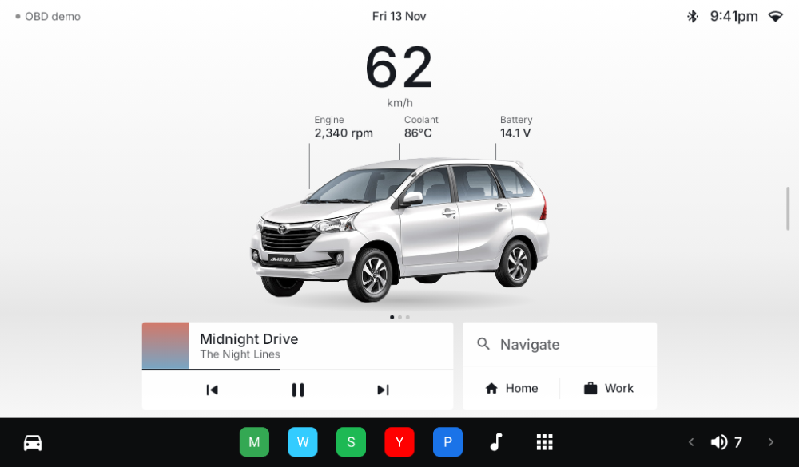
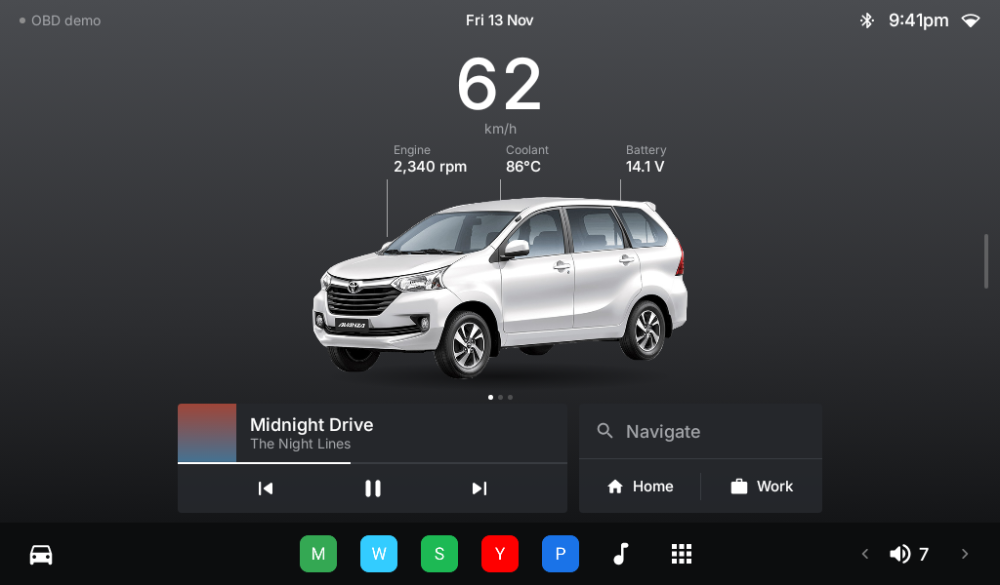
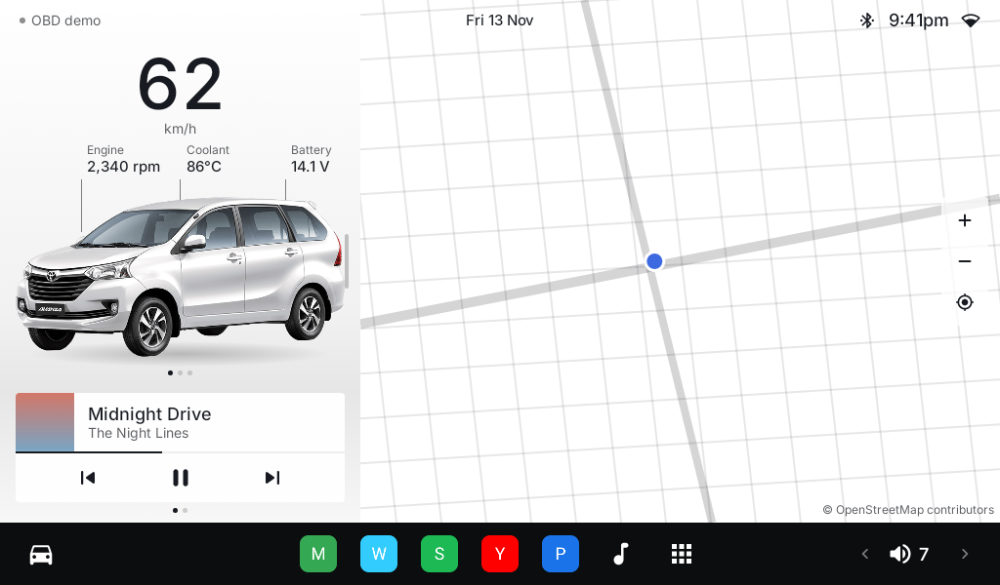
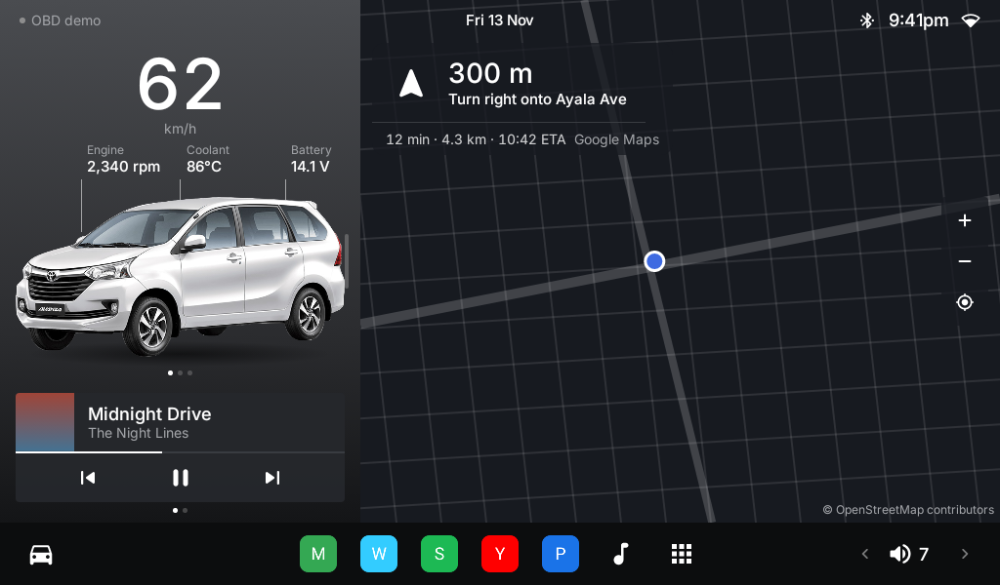

# AHU-TLauncher

A home-screen launcher for Android head units, built with Kotlin and Jetpack Compose. Its look is modelled on Tesla's in-car screen: the car as the hero with a floor reflection and data callouts, a split car/map view, and a dark dock. Colors and type follow [`docs/DESIGN.md`](docs/DESIGN.md). It was made for a **2018 Toyota Avanza (manual)** but works in any car.

| Car view (day) | Car view (night) |
|---|---|
|  |  |
| **Car + map** | **Navigating with Google Maps / Waze** |
|  |  |

These screenshots are rendered offline, so they show a placeholder street grid and letter icons. On the device you see the real map and your real app icons.

## Features
- **Home launcher**: a dock with up to 6 pinned apps, and a searchable app drawer. Long-press an app in the drawer to pin or unpin it.
- **Car view**: shows the Avanza photos bundled in the app, with a floor reflection and callouts for engine RPM, coolant temperature and battery voltage. Tap the car to switch between front, side and rear. Drag or tap the handle on the panel edge to switch between the full-screen car and the car + map split.
- **Warning lights** that appear only when needed: OBD connected, engine cold or overheating, battery voltage out of range.
- **Your own photos**: you can replace any view from the gallery in *Settings → Display → Car images*. Plain white photo backgrounds are removed automatically.
- **Engine data from OBD-II**, read through a Bluetooth ELM327 adapter: speed, RPM, coolant temperature and battery voltage. There's no gear or transmission data, since the car is manual. With no adapter connected, all engine data is hidden and the speed comes from GPS. A **Demo** mode in Settings simulates driving data.
- **Music card**: shows and controls whatever is playing in Spotify, YouTube Music, the radio app and so on.
- **Map**: a vector map (MapLibre + OpenFreeMap, no API key) with day/night styles and a GPS-following arrow in a tilted driving view.
- **Google Maps / Waze turn-by-turn on the dashboard**: while either app is navigating, the next turn, distance and arrival time appear on the map. Tap the card to open the full app.
- **Navigate / Home / Work shortcuts** that open Google Maps, Waze, or ask which app to use.
- **Automatic day and night themes**, switched by sunrise and sunset at your location. You can also force light or dark.
- **Volume control** in the dock.

## Install on the head unit
1. On the head unit's browser, open **https://github.com/iamfercatapang/AHU-TLauncher/releases/latest/download/TLauncher.apk**. You can also find it on the [Releases page](https://github.com/iamfercatapang/AHU-TLauncher/releases/latest). Each change to `main` updates this file automatically.
2. Copy it to the head unit with a USB stick, or download it there, and open it. Allow installing from unknown sources if asked.
3. Press **Home** and choose **TLauncher → Always**. You can also go to *Settings → Permissions → Default home app*.
4. Grant the permissions:
   - **Location**: for the map and the automatic day/night theme.
   - **Notification access** (*Settings → Permissions*): needed for the music card and the Maps/Waze turn card. Nothing leaves the device.
5. Optional: replace the car photos in *Settings → Display → Car images*.

## Updates
TLauncher checks this repo's latest release every 6 hours, and whenever it comes back to the screen if the last check was over an hour ago. When a newer build exists, a toast shows **Update available**. Tap **Update** and it downloads and installs itself.

- The first time, Android asks you to allow TLauncher to *install unknown apps*. Turn that on.
- On Android 12+, later updates install silently. Older Android shows one confirm screen.
- *Settings → About → Check for updates* runs a check right away.

### Signing key (one-time, for the repo owner)
Updates only install if every build is signed with the same key. CI reads that key from four repository secrets: `TLAUNCHER_KEYSTORE_B64`, `TLAUNCHER_KEYSTORE_PASSWORD`, `TLAUNCHER_KEY_ALIAS` and `TLAUNCHER_KEY_PASSWORD`. You add them under *Settings → Secrets and variables → Actions*. Builds without these secrets are not published to the release.

## OBD-II setup (once you have an adapter)
1. Plug the ELM327 into the OBD port under the dashboard and switch the ignition on.
2. Pair it in Android Bluetooth settings. The PIN is usually `1234` or `0000`.
3. In the launcher, go to *Settings → OBD-II* and set *Data source* to **Bluetooth**, then pick the adapter.

Classic Bluetooth adapters such as ELM327 v1.5/v2.1 or Vgate iCar 2 work. BLE-only adapters are not supported yet.

## Build
```bash
./gradlew assembleDebug          # app/build/outputs/apk/debug/app-debug.apk
./gradlew testDebugUnitTest      # unit tests (OBD parser, nav parser, day/night, background removal)
./gradlew recordPaparazziDebug   # re-render the screenshots
```
You need JDK 17+ and Android SDK 35.

## Credits
- Map data © OpenStreetMap contributors; vector tiles and styles by [OpenFreeMap](https://openfreemap.org) / OpenMapTiles. Rendered with MapLibre Native.
- Inter typeface © The Inter Project Authors, SIL Open Font License 1.1 (`licenses/Inter-OFL.txt`).
- Not affiliated with Tesla or Toyota.
