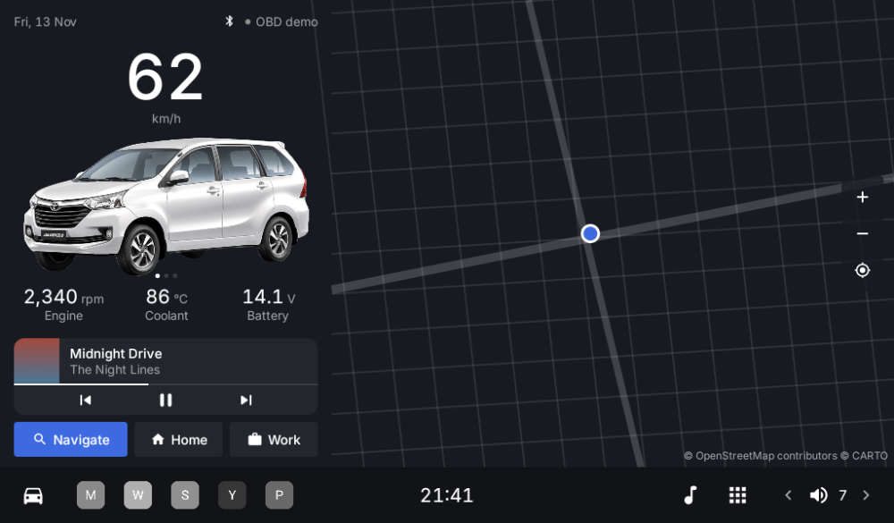

# AHU-TLauncher

A home-screen launcher for Android head units, built with Kotlin and Jetpack Compose. Its look follows a minimal Tesla-inspired design language (see [`docs/DESIGN.md`](docs/DESIGN.md)). It was made for a **2018 Toyota Avanza (manual)** but works in any car.

| Day | Night | Navigating |
|---|---|---|
|  |  |  |

These screenshots are rendered offline, so they show a placeholder street grid and letter icons. On the device you see the real map and your real app icons.

## Features
- **Home launcher**: a dock with up to 6 pinned apps, and a searchable app drawer. Long-press an app in the drawer to pin or unpin it.
- **Car view**: shows your car photos (side, front and rear) taken from the gallery in *Settings → Display → Car images*. Tap the car to switch views. Plain white photo backgrounds are removed automatically.
- **Engine data from OBD-II**, read through a Bluetooth ELM327 adapter: speed, RPM, coolant temperature and battery voltage. There's no gear or transmission data, since the car is manual. Until you have an adapter, a **Demo** mode simulates driving data.
- **Music card**: shows and controls whatever is playing in Spotify, YouTube Music, the radio app and so on.
- **Map**: an OpenStreetMap map with dark and light styles.
- **Google Maps / Waze turn-by-turn on the dashboard**: while either app is navigating, the next turn, distance and arrival time appear on the map. Tap the card to open the full app.
- **Navigate / Home / Work shortcuts** that open Google Maps, Waze, or ask which app to use.
- **Automatic day and night themes**, switched by sunrise and sunset at your location. You can also force light or dark.
- **Volume control** in the dock.

## Install on the head unit
1. Download the APK from the latest successful run under **Actions → Build APK → Artifacts** (`app-release.apk`).
2. Copy it to the head unit with a USB stick, or download it there, and open it. Allow installing from unknown sources if asked.
3. Press **Home** and choose **TLauncher → Always**. You can also go to *Settings → Permissions → Default home app*.
4. Grant the permissions:
   - **Location**: for the map and the automatic day/night theme.
   - **Notification access** (*Settings → Permissions*): needed for the music card and the Maps/Waze turn card. Nothing leaves the device.
5. Add your car photos in *Settings → Display → Car images*.

## OBD-II setup (once you have an adapter)
1. Plug the ELM327 into the OBD port under the dashboard and switch the ignition on.
2. Pair it in Android Bluetooth settings. The PIN is usually `1234` or `0000`.
3. In the launcher, go to *Settings → OBD-II* and set *Data source* to **Bluetooth**, then pick the adapter.

Classic Bluetooth adapters such as ELM327 v1.5/v2.1 or Vgate iCar 2 work. BLE-only adapters are not supported yet.

## Build
```bash
./gradlew assembleDebug          # app/build/outputs/apk/debug/app-debug.apk
./gradlew testDebugUnitTest      # unit tests (OBD parser, nav parser, day/night, background removal)
./gradlew recordPaparazziDebug   # re-render the screenshots
```
You need JDK 17+ and Android SDK 35.

## Credits
- Map tiles © OpenStreetMap contributors © CARTO. These are free basemaps for personal, non-commercial use.
- Inter typeface © The Inter Project Authors, SIL Open Font License 1.1 (`licenses/Inter-OFL.txt`).
- Not affiliated with Tesla or Toyota.
